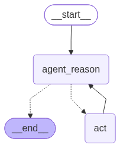

# Logistics Analytics SQL Agent

**Ask a logistics question in plain language. Inspect the executed SQL, explore the actual query results, and read a contextual explanation in one Streamlit workspace.**

This project connects a tool-calling language model to an Apache DataFusion query engine over local CSV files. A LangGraph workflow lets the agent discover tables, inspect their schemas, consult logistics definitions, execute validated SQL, and use the returned data to answer operational questions.

The Streamlit interface and agent responses are in English. Questions can be written in any language supported by the configured model.

## What it does

- Accepts an analytical question through a Streamlit form or the command line.
- Discovers available tables and column types before constructing queries.
- Uses documented relationships and business context to support joins and KPI interpretation.
- Validates SQL and executes queries with DataFusion's DDL, DML, and statement-changing operations disabled.
- Displays database results in interactive `st.dataframe` tables, independently of the model's written answer.
- Keeps SQL, result tables, and the model's explanation in separate tabs.
- Exports displayed rows as UTF-8 CSV, including a byte order mark for spreadsheet compatibility.
- Shows empty results, truncated results, failed query attempts, and actionable API error messages.
- Preserves the latest successful result across Streamlit reruns without automatically repeating the model request.

## Example questions

| Analysis area | Example |
| --- | --- |
| Driver performance | Show the top 10 drivers by trip count, including their names and exact trip counts. |
| Fuel spending | How does total fuel purchase cost change by month? |
| Fleet maintenance | Which 10 trucks have the highest total maintenance cost? |
| Customer revenue | Rank customers by total load revenue. |
| Delivery performance | What percentage of delivery events were on time each month? |

Available answers depend on the CSV files and columns registered at startup. Revenue, fuel cost, and profit are separate business concepts; missing cost components should not be inferred.

## Architecture

1. **Input:** Streamlit submits a question only when the user selects **Analyze**. Each submission starts a separate conversation.
2. **Orchestration:** LangGraph alternates between the reasoning node and the tool node until the model produces a final response, subject to a 30-step recursion limit.
3. **Discovery:** The agent retrieves table names, actual Arrow schemas, documented relationships, and logistics terminology.
4. **Execution:** SQLGlot parses a single query and checks its syntax tree for prohibited operations. DataFusion applies an additional read-only policy when planning the query.
5. **Presentation:** The application extracts structured SQL tool responses from the graph messages. Streamlit renders those rows directly; it does not reconstruct data by parsing a Markdown table generated by the model.



The existing graph image illustrates the reasoning/tool loop. Importing the application does not regenerate the image or contact a diagram service.

### Technology choices

| Component | Responsibility |
| --- | --- |
| Streamlit | Question form, schema browser, interactive tables, status messages, CSV downloads |
| LangGraph | Explicit reasoning/tool execution loop |
| LangChain + `ChatOpenAI` | Model integration and typed tool definitions |
| Apache DataFusion | In-process SQL execution over registered CSV tables |
| Apache Arrow | Table schemas and query result batches |
| SQLGlot | SQL parsing and syntax-tree validation |
| pandas | Tabular presentation and CSV serialization |
| pytest + Streamlit AppTest | Automated SQL, orchestration, and UI checks |
| Ruff + uv | Static checks, formatting, and dependency locking |

The active query engine is DataFusion. The dependency manifest also retains packages from earlier project work; their presence does not imply a running API server or a separate database service.

### Agent tools

| Tool | Purpose |
| --- | --- |
| `list_tables` | List registered CSV tables |
| `get_table_schema` | Inspect actual column names, Arrow types, and nullability |
| `get_table_relationship` | Read documented table relationships |
| `get_business_context` | Retrieve business terminology and KPI guidance |
| `execute_safe_query` | Validate SQL and return structured results or an execution error |

Successful query responses include the SQL, column names, rows, displayed row count, row limit, and a truncation flag. Failed queries remain available for inspection even if a later attempt succeeds.

## Getting started

### Prerequisites

- Python 3.9 or newer; Python 3.11 is recommended for a new environment.
- [uv](https://docs.astral.sh/uv/getting-started/installation/) or pip.
- An OpenAI API key with access to the configured model.
- Logistics CSV files placed in `logisticsDatasetCSV/`.

### 1. Install dependencies

From the repository root:

```bash
uv sync --locked
```

Alternatively, install into a virtual environment with pip:

```bash
python3 -m venv .venv
source .venv/bin/activate
python -m pip install -r requirements.txt
```

On Windows, activate the environment with `.venv\Scripts\activate` instead. The uv workflow uses the committed lockfile; `requirements.txt` is an alternative dependency list, not an exact lock.

### 2. Configure the model

For a new checkout, copy the template and fill in your API key:

```bash
cp .env.example .env
```

If `.env` already exists, edit it directly instead of replacing it.

```dotenv
OPENAI_API_KEY=your_openai_api_key
OPENAI_MODEL=gpt-4o-mini
```

| Variable | Required | Default | Purpose |
| --- | --- | --- | --- |
| `OPENAI_API_KEY` | Yes, for model requests | None | OpenAI authentication |
| `OPENAI_MODEL` | No | `gpt-4o-mini` | Tool-calling chat model |

Environment variables already set in the process take precedence over `.env`. Restart the Streamlit server after changing model settings or credentials. Offline tests do not require an API key.

### 3. Add the dataset

CSV data is excluded from version control by the existing `.gitignore`; a fresh clone includes schema documentation, not the data itself. Obtain the compatible dataset separately or provide your own logistics CSV files. No dataset download or source license is supplied by this repository.

Each top-level `*.csv` file in `logisticsDatasetCSV/` is registered under its filename stem. Files must have a header row; DataFusion infers types from up to the first 10,000 records. For example, `trips.csv` becomes the `trips` table.

The documented dataset contains these entities:

| Group | Tables |
| --- | --- |
| Reference data | `drivers`, `trucks`, `trailers`, `customers`, `facilities`, `routes` |
| Operations | `loads`, `trips`, `fuel_purchases`, `maintenance_records` |
| Delivery and safety | `delivery_events`, `safety_incidents` |
| Monthly summaries | `driver_monthly_metrics`, `truck_utilization_metrics` |

See [DATABASE_SCHEMA.txt](logisticsDatasetCSV/DATABASE_SCHEMA.txt) for documented keys and relationships and [business_context.txt](business_context.txt) for business terminology. When using a different dataset, update these files to match it. CSV files do not enforce the documented key constraints.

Restart the server after adding or changing dataset files so the registered tables and inferred schemas are refreshed.

### 4. Run Streamlit

```bash
uv run streamlit run streamlit_app.py
```

For a pip environment:

```bash
python -m streamlit run streamlit_app.py
```

Open the local URL printed by Streamlit, normally `http://localhost:8501`. Check the available tables in the sidebar, enter a question, and select **Analyze**.

| UI section | Contents |
| --- | --- |
| Sidebar | Registered table count and column schemas |
| Data tables | Actual query rows and CSV downloads |
| Insights | The model's explanation |
| SQL queries | Executed SQL and failed query attempts |

### Command-line usage

```bash
uv run python sql_agent.py "Show the top 10 drivers by trip count."
```

Running `uv run python sql_agent.py` without an argument prompts for a question interactively.

## Validation

Run the deterministic suite without sending requests to OpenAI:

```bash
uv run pytest
uv run ruff check .
```

The suite exercises real DataFusion queries against synthetic tables, rejects unsafe SQL, verifies row limits and empty results, checks structured tool-result extraction, and submits Streamlit forms through AppTest with the model boundary replaced by a test double.

The live integration test requires the complete logistics dataset and a working API key. It sends requests to OpenAI and may incur API charges:

```bash
uv run pytest -m integration tests/test_sql_agent.py
```

This test compares the agent's top-driver response with a direct DataFusion query. Model output and service availability can affect live test results; deterministic tests run separately by default.

## Engineering decisions and boundaries

- **Structured results are the table source.** SQL tool responses supply column names even when a query returns zero rows. The model's explanation is presented separately and can still contain mistakes.
- **Results are bounded after query evaluation.** Each SQL result exposes at most 100 rows. Fetching one additional row detects truncation without confusing an exact 100-row result with a larger result. Aggregate calculations operate on the input data before this output limit. The limit does not bound total query time or memory use.
- **Read-only checks exist at two layers.** SQLGlot blocks multiple statements, mutation statements, `SELECT INTO`, and locking clauses; DataFusion independently disables DDL, DML, and configuration statements. SQLGlot uses its PostgreSQL parser for validation, while DataFusion remains the authority for supported execution syntax. This is a local analytics guardrail, not a security sandbox for a public service.
- **Model setup is deferred.** Importing tools and running offline tests do not initialize an authenticated model client. The model client is reused after its first request, with a 60-second request timeout and up to two SDK retries.
- **State is scoped to the browser session.** Only the latest analysis is kept in Streamlit session state. Ordinary reruns retain it; a new submission clears the previous result before execution. Browser reloads can reset the session. Previous questions are not passed to the next request.
- **Data leaves the application for model inference.** Questions, discovered metadata, business context, and returned query rows may be sent to OpenAI. Use data you are permitted to process with the configured service.
- **Deployment controls are outside the current scope.** Authentication, per-user data isolation, durable audit logs, and hard query resource limits are not implemented. All sessions use the same local dataset.

## Project layout

```text
.
├── streamlit_app.py              Streamlit interface and UI error handling
├── analytics.py                  Application service and structured result extraction
├── sql_agent.py                  LangGraph assembly and interactive CLI
├── nodes.py                      System instructions and reasoning/tool nodes
├── react.py                      Discovery tools, SQL validation, model factory
├── database/
│   └── datafusion.py             CSV registration and DataFusion context
├── logisticsDatasetCSV/
│   └── DATABASE_SCHEMA.txt       Documented entities and relationships
├── business_context.txt         Logistics terminology and KPI guidance
├── tests/                       Offline tests and opt-in live integration test
├── .env.example                 Configuration template without credentials
├── pyproject.toml               Dependencies and test configuration
├── requirements.txt             pip installation alternative
├── uv.lock                      Resolved dependency versions
└── flow.png                     Agent workflow image
```

## Troubleshooting

| Symptom | Resolution |
| --- | --- |
| **Analyze** is disabled | Configure `OPENAI_API_KEY`, add CSV files, and restart the application. |
| No tables are listed | Check that CSV files are directly inside `logisticsDatasetCSV/`, with readable headers. |
| CSV loading or type errors | Check delimiters and inconsistent column values beyond the schema inference sample. |
| Authentication or quota error | Verify the API key, model access, and API account usage limits. |
| Empty result table | Check date filters and values; zero matching rows is a successful query outcome. |
| Truncation notice | Narrow filters or request an aggregation; CSV downloads include only displayed rows. |
| Agent reaches its step limit | Ask a narrower question with a specific metric, grouping, and date range. |

## References

- [Streamlit interactive dataframes](https://docs.streamlit.io/develop/api-reference/data/st.dataframe)
- [Streamlit AppTest](https://docs.streamlit.io/develop/api-reference/app-testing/st.testing.v1.apptest)
- [DataFusion Python SQL API and execution options](https://datafusion.apache.org/python/autoapi/datafusion/context/index.html)
